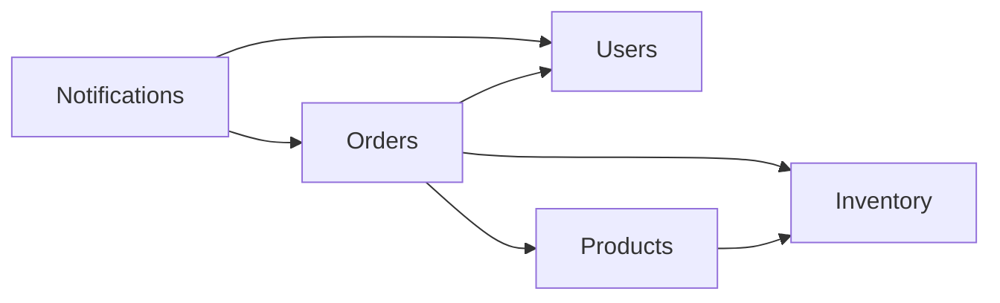

# NovaCart — Distributed Real-Time E-Commerce Platform

## 1. Purpose, authority, and milestone order

Build a small, secure, distributed shop for the Damascus University Internet Applications project (2026). The course emphasizes architecture, security, performance, scaling, and monitoring; frontend appearance and feature count are not assessment goals.

This specification separates **course requirements**, **repository design decisions**, and **observed implementation evidence**. A requirement or design described here is a target, not a claim that code exists or tests pass.

Source presentations, converted slide by slide into English:

- [Requirements 1 and 2](docs/requirements/requirements-1-2.md): 15 slides; abbreviated below as **R12**.
- [Requirement 3](docs/requirements/requirement-3.md): 12 slides; abbreviated below as **R3**.
- [Requirement 4](docs/requirements/requirement-4.md): 12 slides; abbreviated below as **R4**, supplemented by the [interview checklist image conversion](docs/requirements/requirement-4-interview.md).

The presentations govern course obligations. This file governs the repository's chosen implementation of those obligations. README descriptions, collection assertions, comments, and example scripts are supporting evidence, not proof of correctness. When they disagree, reconcile them explicitly rather than silently changing the course scope.

**Current priority:** requirements 1–3 have local technical verification, including the cache/routing corrections in commit `3bc965a` and [the latest verification report](docs/verification/2026-11-17-cache-routing.md). Shared review, merge/deployment and per-member course participation remain separate from local technical evidence. Requirement 4 now has implementation, automated verification, real Gmail inbox receipt and a visible two-browser demonstration (see section 7); clean production-image build and shared course/team sign-off remain separate. Requirements 5–6 remain roadmap context only.

## 2. Course requirements and acceptance criteria

### Requirement 1 — API Design & Security

| ID | Course obligation | Acceptance evidence | Source |
| --- | --- | --- | --- |
| R1-01 | Register users; add/display products and images; create orders, manage inventory, track status | Demonstrate these functions through documented API requests | R12 slide 2 |
| R1-02 | Organize the core application into Users, Products, Orders, Notifications | Four domain modules with clear responsibilities and wiring; explain boundaries during assessment | R12 slide 5 |
| R1-03 | Run the complete project in separate Docker containers | A clean build and startup of the complete stack, persistent databases, reachable API | R12 slide 5 |
| R1-04 | Product creation with image, listing, category filtering, pagination | Valid upload displays with the product; filters return matching records; pagination has stable metadata | R12 slide 6 |
| R1-05 | Create/display orders and change their status | Customer creates and reads their order; administrator changes status according to the documented lifecycle | R12 slide 6 |
| R1-06 | REST version in the path, correct HTTP codes, one error format | All API routes share `/api/v1`; success and failure responses follow the selected contract | R12 slide 6 |
| R1-07 | Easily executable API documentation | Postman Collection, OpenAPI/Swagger, or equivalent covers the implemented interfaces and required demonstrations | R12 slide 6 |
| R1-08 | JWT authentication and role enforcement | Protected routes reject missing/invalid/expired tokens; public registration cannot grant admin privileges | R12 slide 7 |
| R1-09 | Customers see only their own orders; only admins change status | With two customers, foreign order read returns 403; customer status mutation returns 403 with no data changes; admin operations succeed | R12 slides 7–8 |
| R1-10 | Limit login attempts and provide basic security headers | Demonstrate 429 after the configured allowance; inspect security headers on successful and failed responses | R12 slide 7 |

The course permits the team to choose the language/framework. It requires testable documentation, not Swagger specifically. It does not specify an exact login threshold, error envelope, upload limit, or set of order statuses; those are repository decisions below.

### Requirement 2 — Inter-Service Communication

| ID | Course obligation | Acceptance evidence | Source |
| --- | --- | --- | --- |
| R2-01 | Independent inventory service in a different language or framework, owning a separate database | Core accesses inventory only over gRPC through a shared `.proto`; no direct inventory SQL or shared stock table | R12 slides 9–10 |
| R2-02 | Contract supports query, reserve, return quantity | Real gRPC requests demonstrate all three operations; existing additional `SetStock` supports administration | R12 slide 11 |
| R2-03 | Product details retrieve available quantity from warehouse | Changing warehouse stock changes the displayed quantity; catalog storage is not the stock authority | R12 slide 11 |
| R2-04 | One request reserves all items before order creation | A multi-item order either reserves all quantities or none; rejected reservation creates no order | R12 slide 11 |
| R2-05 | Insufficient stock rejects checkout with a clear message | HTTP 409 identifies shortages; local order and all inventory quantities remain unchanged on rejection | R12 slide 12 |
| R2-06 | Every call has a deadline; stopped/slow warehouse gets a clear response | Real outage and slow-service demonstrations finish within a measured bounded interval; checkout returns structured 503 | R12 slides 12–13 |
| R2-07 | Return reserved quantity when saving the order fails | Force local persistence failure after successful reservation; no order is committed and all reserved stock is restored | R12 slide 12 |
| R2-08 | Concurrent checkouts for the last unit yield exactly one winner | With stock 1 and multiple independent buyers, exactly one 201, all other requests 409, final stock 0, exactly one persisted order | R12 slide 13 |

The course does not prescribe SQL lock syntax, UUIDs, exact HTTP failure codes, or a 2000 ms deadline. These are chosen implementation details that make the course behaviors concrete.

## 3. Repository architecture decisions

### Core, inventory, and containers

- Laravel/PHP implements the REST core. The manifest currently requests Laravel `^13.17`; the app Dockerfile targets PHP 8.5. Use manifests/lockfiles and Dockerfiles for actual versions rather than older README labels. No framework upgrade is part of this specification work.
- `laravel-app/app/Modules/` holds Users (identity/JWT/roles), Products (catalog/categories/images), Orders (cart/checkout/ownership/lifecycle), and Notifications (user messages). The Inventory integration module is an adapter to the independent service, not a replacement for one of the four domain modules.
- Cross-module operations use explicit services/contracts. Database ownership remains clear. The course does not impose a blanket ban on joins within the core database.
- The PHP runtime uses the pinned PHP 8.5.12 Debian/amd64 base recorded in the Dockerfile. The native gRPC 1.85.0 extension is shared as a compressed artifact in [docker/php/extensions](laravel-app/docker/php/extensions/README.md); the build verifies ABI, architecture, checksum and loaded version instead of compiling gRPC. Runtime upgrades must replace and reverify the artifact with its base. App and scheduler share `localhost/novacart-core:local`, built by the app service once.
- Node.js inventory uses gRPC and PostgreSQL. The shared contract is [inventory.proto](proto/inventory/v1/inventory.proto), package `inventory.v1`.
- Compose defines `app` (PHP-FPM), `web` (Nginx, host port 8080 by default), `db` (core PostgreSQL), `inventory` (internal gRPC port 50051), `inventory-db` (separate PostgreSQL), and `scheduler` (the same core image running Laravel scheduled recovery). The scheduler waits for PHP-FPM health after migrations. Persistent volumes retain storage and database data.
- The core has no direct inventory database access. Inventory product identifiers correspond to catalog identifiers without cross-database foreign keys.
- Refresh/logout, cart, category administration, and persistent notifications are existing project design choices beyond the course's minimum endpoint list. Asynchronous notification delivery and WebSockets are available through the optional requirement 4 Compose overlay described in section 7.

### Module ownership and public interfaces

The core is one deployable Laravel modular monolith. Each module owns its queries, models, controllers, and business rules. The shared database and existing foreign keys remain; they do not grant another module permission to query or relate to the owning module's models.

| Module | Owned data / responsibility | Public integration surface |
| --- | --- | --- |
| Users | Users, authentication, roles, recipient identity/delivery | `Users\PublicApi\Actor` and `UserDirectory`: actor identity, batch profile values, notification delivery to user IDs/admins |
| Products | Products, categories, images, catalog availability | `Products\PublicApi\Catalog` returns immutable `CatalogProduct` values, including transaction-scoped `lockForCheckout` snapshots; public stock/deletion errors and product lifecycle events |
| Orders | Carts, cart items, orders, order lines, checkout/lifecycle | Immutable `Orders\PublicApi\OrderSummary` and committed order events; subscribes to product deletion events using Orders-owned data |
| Notifications | Notification payloads, inbox/read-state queries | Consumes order snapshots and asks Users' public directory to deliver framework notifications; inbox queries are scoped by actor ID |
| Inventory adapter | PHP gRPC translation and deadlines | Existing `Inventory\Contracts`, `Data`, and `Exceptions`; generated messages/client code remain private to the adapter |

Allowed compile-time module dependencies are acyclic:



Cross-module reads return immutable snapshots or plain profile arrays, never Eloquent models, query builders, relationships, or HTTP resource objects. The authenticated user is accessed through the small `Actor` identity interface. Foreign IDs are scalar values; ORM relationships exist only between models owned by the same module. Profile and catalog enrichment is batched for entire order pages.

Products dispatches the synchronous public `ProductDeleting` event while holding its own product-row lock. Orders checks pending orders and history in its own tables and can refuse deletion or request retention. Products performs its own hard/soft deletion, then publishes `ProductRemoved`; Orders removes its own cart lines. This preserves the deletion rules without a Products-to-Orders import. The deletion guard must remain synchronous.

Committed order events carry readonly `OrderSummary` data and string status values rather than live models/enums. Notifications therefore uses the facts at dispatch time and cannot query or mutate Orders internals. Existing notification types, JSON fields, status transitions, and HTTP routes remain compatible.

Run the standalone dependency guard from `laravel-app/`:

```fish
php tests/Architecture/check-modules.php
```

It checks references against the public surfaces and dependency direction, and checks ownership/resolution of ORM relationship targets. `composer test:architecture` runs it too; `composer test` includes it before the Laravel suite. This is a source guard, not a complete semantic analyzer; runtime interface and authorization checks remain necessary. Factories, migrations, and integration tests outside `app/Modules/` may compose multiple modules to build fixtures/schema.

### REST compatibility baseline

Use the paths already exercised by the committed Postman collection and race script as the intended compatibility baseline. The merged application registers these routes; the verification pass exercised the principal workflows. See [the verification record](docs/verification/requirements-1-2.md) for outcomes and remaining checks.

All paths below are relative to `/api/v1`:

| Access | Method and path | Purpose |
| --- | --- | --- |
| Public | `POST /register`, `POST /login` | Customer registration and JWT login |
| Authenticated | `GET /me`, `POST /refresh`, `POST /logout` | Identity and token lifecycle |
| Public | `GET /` | Catalog listing with `page`, `category`; optional existing `q` search |
| Public | `GET /products/{id}` | Product details with live inventory quantity |
| Admin | `POST /admin/products` | Multipart product/image creation |
| Admin | `PUT /admin/products/{id}`, `DELETE /admin/products/{id}` | Existing catalog maintenance extension |
| Admin | `PATCH /admin/products/{id}/stock` | Absolute quantity update through gRPC `SetStock` |
| Admin | `GET/POST /admin/categories`, `PUT/DELETE /admin/categories/{id}` | Existing category management extension |
| Customer | `GET/DELETE /cart`, `POST/PATCH/DELETE /cart/{productId}` | Manage the customer's cart |
| Customer | `GET /checkout`, `POST /orders` | Preview and checkout the server-side cart |
| Customer | `GET /orders`, `GET /orders/{id}` | Own orders; foreign existing order returns 403 |
| Admin | `GET /admin/orders`, `PATCH /admin/orders/{id}/status` | All orders and privileged status updates |
| Authenticated | `GET /notifications`, `PATCH /notifications/{id}/read`, `POST /notifications/read-all` | Own notifications and read state |

Do not introduce `/auth/login`, move product creation to `/products`, or move admin status updates to the customer namespace solely to match the old SPEC. Any deliberate route change must update clients, documentation, and tests together.

Orders are created from the customer's cart (no client-supplied order prices). Validate positive integer quantities and existing product identifiers; resolve prices and total on the server and persist order-line price snapshots. Use exact monetary arithmetic. Checkout obtains ordered primary product-row locks through Products\PublicApi\Catalog::lockForCheckout inside the cart/order transaction; product deletion uses those same rows, so it either wins before checkout validation or waits and refuses the newly pending order. Orders may total at most 99,999,999.99, matching NUMERIC(10,2); reject larger aggregates with field error `total_amount` and HTTP 422 before Reserve. Carts/orders allow at most 100 distinct products to fit the existing single-RPC inventory limit; reject new excess lines and preexisting oversized checkout with field error `cart` and HTTP 422. Serialize cart read/modify/write operations and checkout consumption using the same persistent cart-row lock; clear purchased contents in the order transaction so concurrent additions survive and one cart revision cannot be purchased twice. Product creation fields follow the collection: `title`, `description`, `price`, `category_id`, `image`, and initial `stock_quantity`. The upload target is JPG/PNG/WebP, at most 5 MB, validated by actual content/MIME and size.

Use lowercase order statuses as documented in the collection: initial `pending`; transitions `pending -> completed`, `pending -> cancelled`, `completed -> cancelled`. Cancellation returns inventory at most once. A durable cancellation intent commits before Release; while it is pending, incompatible status requests return 409. `orders:recover-cancellations` retries these intents every minute through the existing scheduler, including after an ambiguous Release response or local persistence failure. Order status becomes cancelled and the intent completed atomically; the public status enum remains unchanged. Other invalid transitions return 422. This lifecycle is a project choice, including cancellation of completed orders; adding fulfillment/payment semantics requires an explicit design change.

Product creation requires initial stock. Product updates accept an optional `stock_quantity`: omitting it preserves live inventory; including it explicitly adjusts the absolute warehouse quantity. The GUI disables stock on metadata edits unless the administrator enables “Adjust warehouse stock when saving.” Generated category slugs fit VARCHAR(120), reserving space for collision suffixes even when Unicode transliteration expands a valid name.

Registration requires confirmed passwords of at least eight characters, rejects NUL characters, and limits bcrypt inputs to 72 UTF-8 bytes before hashing. These validation failures return 422 field errors, not server errors.

Catalog defaults bootstrap once through a transactional `bootstrap_state` ledger. On upgrade, any existing users/categories/products mark catalog bootstrap complete, preserving managed edits and intentionally empty catalogs. Fresh installations initialize defaults and mark completion in one transaction. Subsequent full or individual catalog seed runs skip completed bootstrap; administrator credential synchronization remains separate. Preserve the ledger in backups and do not reset it to repair a managed catalog. Nginx discovers the container runtime's DNS and re-resolves the PHP backend (five-second DNS cache), allowing recovery after app restarts/IP changes on Docker or Podman.

Category creation and rename allocate names/slugs inside a Products-owned transaction and a PostgreSQL transaction-level advisory lock for the whole namespace. Name uniqueness is rechecked after acquiring that lock; the database unique constraints remain authoritative. SQLite behavior tests do not establish concurrent PostgreSQL correctness.

Product image replacement and deletion read the current image path while holding the product row lock. Post-commit cleanup removes that captured superseded file rather than a stale route-bound path.

Authentication rate limits normalize only string email values; malformed types reach normal field validation. Administrator bootstrap trims/lowercases configured email, finds canonical legacy identities without duplicating usernames, and can retain the configured administrator's ID when its address changes. Ambiguous legacy case variants are refused rather than silently merged/promoted; resolve ownership explicitly before retrying bootstrap.

The GUI API client shares one refresh per current token, preserves credentials on transient refresh/startup outages, and rejects responses from an earlier login. Explicit sign-out/account changes clear private views; delayed responses cannot replay mutations under another account or repopulate its private panels. Token rotation stays within the same session. This coordination is per GUI client; server blacklist grace remains unchanged.

### Response and security contract

Successful resource responses use a `data` payload; registration/login include the `token` consumed by existing clients. Product details expose `stock_quantity`; paginated listings include navigation/metadata. Preserve the existing field schemas and reconcile executable documentation when interfaces change.

Use the error envelope already asserted by the Postman collection and described in README:

```json
{
  "status": 422,
  "code": "validation_failed",
  "message": "The given data was invalid.",
  "errors": { "email": ["The email field must be a valid email address."] }
}
```

`status` is the numeric HTTP status, `code` is a stable machine-readable string, `message` is safe for clients, and optional `errors` contains field errors. The same shape applies to authentication, authorization, validation, missing-resource, throttle, service, and internal failures. Production errors exclude stack traces and credentials. Do not introduce the old SPEC's incompatible `success/error/timestamp` envelope.

| Situation | HTTP status |
| --- | --- |
| Resource/order created | 201 |
| Read/update successful | 200; 204 allowed for documented bodyless deletions |
| Missing/invalid/expired bearer token | 401 |
| Incorrect login credentials (existing validation-style contract) | 422 |
| Forbidden role or foreign existing order | 403 |
| Missing resource | 404 |
| Stock shortage or documented business conflict | 409 |
| Invalid input, empty cart, invalid transition, excessive cart lines or order total | 422 |
| Order cancellation pending recovery; incompatible status change | 409 |
| Rate limit exceeded | 429 |
| Unexpected local persistence failure | 500 |
| Inventory unavailable/deadline exceeded | 503 with `Retry-After: 5` |

JWT uses Bearer authentication, HS256 by default, and a 60-minute default lifetime per `config/jwt.php`. Validate identity and current authorization; derive ownership from the authenticated user rather than submitted user IDs. Keep secrets in the environment. Refresh/logout blacklisting is a project choice and must be verified separately from basic JWT issuance.

The existing `auth` limiter allows 6 requests per minute for normalized email plus IP; the global `api` limiter allows 60 per minute per authenticated identity or IP. Verify that sensitive routes actually attach these limiters. Test the auth limit without accidentally hitting the global limit first. Thresholds are project choices, not course numbers.

Provide `X-Content-Type-Options: nosniff`, `X-Frame-Options: DENY`, a suitable `Referrer-Policy`, and a restrictive Content Security Policy appropriate to the served content. Apply HSTS when HTTPS is deployed. Exact header policy is a project decision; the course asks for basic security headers. Authorization must occur before inventory or other privileged side effects.

### Functional customer/admin interface

The source slide excludes evaluation of frontend **design**, not explicitly a working frontend. The agreed repository scope includes a basic GUI at `/`, using the existing `/api/v1` endpoints. Customers can register/sign in, search/filter/page products, view images and availability, manage quantities in their cart, check out, read their orders, and manage notifications. Administrators can manage categories and products (including images/stock), inspect the dashboard and all orders, and change status. Visual polish is outside the acceptance gate.

The interface uses dedicated product screens and hash routes for navigation, browser Back/Forward and deep-link reloads. Category selection uses names; catalog responses add public `categories` and `currency` metadata (detail responses also include `currency`). The cart exposes counts, quantities and an order summary. Guest purchase intent resumes after sign-in. Administrator overview/products/categories/orders are separate panels with a modal product editor. Messages use dismissible toasts or inline form errors, not product-detail presentation. See the [GUI usability follow-up](docs/verification/gui-usability.md) for the corrected browser checks.

The interface uses a dark palette and local JavaScript/CSS without a frontend package install or build service. Catalog rendering keeps the latest request so delayed earlier responses cannot overwrite a newer filter/page. Stable asset paths require browser revalidation after deployments. User-supplied text is rendered with DOM text nodes. JWTs live in per-tab `sessionStorage`, refresh through the API and are removed on sign-out. All authorization, ownership, prices and stock decisions remain server-side. The shop CSP permits same-origin scripts/styles/images/connections; API CSP remains `default-src 'none'`. Proxy-generated errors use the JSON envelope, including 413 oversized requests and 502 unavailable PHP. Application FastCGI errors keep Laravel's response body.

## 4. Inventory contract, checkout, and failure semantics

The `.proto` is the authority for RPC names and wire types. Use `Reserve` and `Release`, not the old SPEC's inconsistent `ReserveStock`/`ReleaseStock` names.

| RPC | Chosen semantics |
| --- | --- |
| `GetStock` | Batch query by product IDs; unknown inventory products have quantity 0 |
| `Reserve` | One caller-supplied UUID `reservation_id`, all order items in one atomic transaction; result `RESERVED`, `REJECTED` with shortages, or `RELEASED` |
| `Release` | Return a reservation's stock once; repeated release is safe; an early release prevents a delayed reserve using that ID |
| `SetStock` | Set an absolute nonnegative quantity for an authorized admin action routed through the core |

Validate inventory requests independently of HTTP validation. Normalize duplicate product lines consistently and reject malformed/nonpositive quantities. A repeated reservation with the same ID and same normalized payload must not deduct stock twice; reuse with different items must be rejected clearly. Keep reservation outcome and stock changes consistent in one database transaction.

Choose transactional row locking (`SELECT ... FOR UPDATE`) with locks acquired in sorted product-ID order, plus a database `CHECK (quantity >= 0)`. If any line is short, no line is deducted. Serialize reservation/release races by reservation ID as well as product rows; product locks alone do not establish reservation idempotency. Verify `SetStock`, reservation, and release do not lose concurrent updates.

Checkout coordination is **reservation followed by local commit with compensation**, not a distributed two-phase commit protocol:

1. Authenticate, generate a stable reservation UUID, and commit a `checkout_reservations` intent outside the subsequent cart/order transaction so it survives process death.
2. In a new core transaction, lock that intent, then the customer cart row before reading it. Validate line count and aggregate monetary bounds, snapshot authoritative prices, and call `Reserve` once for all items.
3. On `REJECTED`, return 409 with shortages and create no order. `RELEASED` must not be treated as a successful reservation.
4. On `RESERVED`, save the order and lines in a local transaction, associate its reservation UUID, mark the intent committed and clear the purchased cart in that same transaction; return 201 after commit.
5. If saving fails, roll back the local transaction and invoke idempotent `Release` for that UUID. Verify stock restoration and return a structured local failure.
6. Publish notifications only after order/cart commit. If validation fails before any Reserve attempt, finish the unused intent locally without a remote Release. A notification failure after commit must not release stock for an already committed order.

Every RPC has an explicit deadline, default `INVENTORY_TIMEOUT_MS=2000`. Map unavailable/expired-deadline calls to a safe 503 response. Measure end-to-end duration, accounting for any compensation calls; a per-call deadline does not imply the entire HTTP request finishes in exactly 2000 ms.

A timed-out reserve may have executed remotely. Use the same reservation UUID for cleanup/reconciliation; never blindly create a second reservation on retry. The early-release behavior in the `.proto` addresses delayed reserve arrival, but does not by itself solve process crashes or failed compensation. If release also fails, the committed intent remains pending. `orders:recover-reservations` reconciles pending intents older than five minutes; the Compose scheduler runs it every minute. Recovery locks the same intent and checks for a committed order before releasing stock, including after an ambiguous database commit response. A crash rolls back the in-flight core transaction and frees its lock, leaving the intent for recovery. A late checkout that loses to recovery refuses the released intent. Recovery retries use the original UUID and idempotent Release. Never claim a best-effort release guarantees no leaked reservations under every failure.

For catalog browsing during outage, the existing outage collection expects catalog data to remain available with `stock_quantity: null` (unknown), while checkout returns 503. An unknown quantity must not be presented as real zero or used as permission to accept an order. Successful product detail requests retrieve current quantity through `GetStock`.

## 5. Verification gate for requirements 1 and 2

Completion requires executable evidence, not just source files or mocked tests. Record commands, environment, assertions, and outcomes when this gate is run.

| Check | Required observation |
| --- | --- |
| Complete startup | All service build contexts and providers exist; clean Docker build/start, migrations, seed and health checks succeed |
| Core API/security | Registration/login, image validation, category filtering, pagination, cart checkout, status tracking, notifications, standardized errors and headers |
| Required authorization proof | Two distinct customers; foreign order access and admin-only mutation fail without side effects; admin succeeds |
| JWT and throttling | Missing/invalid/expired tokens rejected; public role escalation rejected; configured login allowance leads to 429 |
| Real inventory contract | `GetStock`, multi-item atomic rejection/success, idempotent reserve/release, early release and duplicate payload handling |
| Required last-unit proof | At least two buyers with independent carts; one 201, all others 409, final stock 0, one saved order |
| Required outage proof | Stopped and slow inventory cases return bounded, structured failures; browse shows unknown stock; normal checkout recovers when service is available |
| Compensation proof | Forced persistence failure after reservation restores every quantity, creates no order; failed cleanup is recoverable or explicitly recorded as a gap |
| Documentation/workflow | Executable documentation matches routes; required teammate-reviewed PR participation evidence exists |

Use Laravel HTTP tests for authorization, validation, and orchestration. An `InventoryGateway` fake can isolate core behavior, but cannot prove PostgreSQL locking, gRPC interoperability, or network deadlines. Verify those against the real Node.js/PostgreSQL service and run concurrency through the public API. SQLite tests cannot prove PostgreSQL concurrency behavior.

Existing artifacts:

- [Main Postman collection](docs/api/NovaCart.postman_collection.json).
- [Outage Postman collection](docs/api/NovaCart-inventory-outage.postman_collection.json).
- [Race demonstration](docs/demo/race-condition.mjs), [slow inventory](docs/demo/slow-inventory.mjs), and [persistent restart](docs/demo/persistence-restart.mjs).
- [Durable recovery demonstration](docs/demo/reservation-recovery.php) and [browser acceptance](docs/demo/gui-browser.mjs).

### Current implementation and verification — 2026-11-11

Work is on `test/requirements-1-2-acceptance`, based on merged main `5e06d54`, with focused progressive commits. Main has not been changed or pushed.

**Architecture:** a modular Laravel monolith plus the independent inventory service required by requirement 2. Core modules share one runtime/database and communicate through acyclic public interfaces and snapshot events. The scheduler runs the same monolith; it is not a new domain service. The source dependency guard passes.

The [final requirement-by-requirement audit](docs/verification/final-requirements-1-2.md) reran the technical gate on 2026-11-11, including the dark GUI, all 33 documented API routes, failure cases and full-stack persistence.

Technical requirements 1–2 and the agreed basic GUI have passing acceptance evidence:

- App, web and inventory images built from source using cached base/native layers and locked dependencies; final app/web builds also passed with networking disabled. Six isolated containers booted with migrations, seeding and scheduled recovery.
- **89 Laravel tests, 406 assertions**, with failure-on-warning/notice enabled, and **15 real gRPC/PostgreSQL tests** passed.
- Real HTTP security/catalog/order/notifications and module-boundary demos passed. Last-unit test: ten buyers, one 201, nine 409s, one persisted order, stock zero.
- Stopped inventory returned structured 503 in 1107 ms with a 500 ms test per-call deadline; stock visibility recovered in 946 ms after restart. Slow-service and persistence-failure demonstrations passed.
- Real recovery demonstrated a process exiting with reserved stock, a failed release while inventory was down, and later stock restoration exactly once. Scheduler execution was observed.
- Proxy-generated 413, 403 and 502 responses passed JSON/status/header checks. Browser tests passed customer checkout, notifications, administrator category/product/image creation and rendering, and order status changes, reload authentication, and a 390 px layout without overflow or runtime/CSP errors.
- Complete restart of all six containers preserved seven existing orders, catalog quantities and an existing JWT using disposable named database/storage volumes.
- Earlier approved dependency downloads totaled **31,284,418 bytes (29.84 MiB)** through a counting proxy capped at the approved 100 MiB. No images or host packages were downloaded.

[The verification record](docs/verification/requirements-1-2.md) preserves commands, detailed scope, earlier failures and current evidence. These are functional acceptance results, not proof against every distributed failure: recovery needs a reachable core database and eventual inventory availability; product administration and cancellation still span independent databases without a distributed transaction. No high-volume performance claim is made.

The **technical requirements 1–2 gate is satisfied** under the user's agreed scope. Course participation is explicitly set aside by the user; main protection/one-review enforcement was previously verified, but per-member coverage is not being signed off. At that historical gate, requirement 3 was still deferred; section 6 and subsequent verification supersede that status.

## 6. Requirement 3 — active performance and caching milestone

New evaluator runs can use the k6 workload and sequential runner in
`docs/performance/load.k6.js` and `docs/performance/run-k6.mjs`; follow
[the verification and reproduction guide](docs/verification/2026-11-17-cache-routing.md). Existing committed load
numbers belong to the original Node workload and must not be mixed with new k6
measurements. The k6 runner labels stages but does not change indexes or routing.


The user advanced to this milestone after the requirements 1–2 technical gate passed. Implementation and evidence are tracked in [the performance record](docs/performance/README.md). Preserve JWT/ownership protections, inventory authority, reservation atomicity, and bounded failure handling throughout optimization.

| ID | Course obligation | Acceptance evidence | Source |
| --- | --- | --- | --- |
| R3-01 | Measure, change one thing, measure again | Comparable baseline/after runs with explanations; unsupported speed claims do not count | R3 slides 3–4 |
| R3-02 | Realistic database scale and query optimization | Hundreds of thousands of synthetic orders, recorded `EXPLAIN` plans, justified indexes/query changes, identified and fixed N+1 queries | R3 slide 6 |
| R3-03 | Automatically replicated read-only database | Writes go to primary; eligible reads use replica; prove actual replication and read routing | R3 slide 7 |
| R3-04 | Read-your-writes despite replication lag | User immediately sees a newly created entity and product changes; test with replication delay | R3 slides 7, 11 |
| R3-05 | Redis caching for frequently read data | Defined keys and TTLs, correct invalidation after mutations, no stale product output | R3 slide 8 |
| R3-06 | HTTP conditional caching | Product response has ETag; matching conditional request returns bodyless 304; mutation changes data/ETag | R3 slide 9 |
| R3-07 | Reproducible load testing | Same k6/equivalent workload before/after; report p50, p95, p99 and requests/second; explain observed behavior | R3 slides 10–11 |

Implemented decisions and evidence:

- [Performance record](docs/performance/README.md) contains the 200,000-order / 600,000-line dataset, baseline plans, cumulative one-index-at-a-time plans, before/after p50/p95/p99/RPS, and a controlled replica-then-cache comparison. All recorded requests returned 200. Local shared-host timing limitations are explicit.
- Three measured indexes cover order-item lookup, newest orders, and customer/newest orders. The existing batched presentation already keeps one and eight orders at five SQL queries; no new N+1 fix is claimed.
- [Performance Compose overlay](docker-compose.performance.yml) adds a physical PostgreSQL standby with automatic WAL streaming, a SELECT-only reader, and Redis. It supports an existing primary volume. It is optional; plain Compose remains the requirements 1–2 deployment.
- Ordinary database reads use Laravel's read PDO, gated by a request-scoped WAL fence policy; database mutations, transactions, locking queries, authentication (credentials and JWT blacklist), complete order-detail/status and product-maintenance responses, notification marking, route binding and authoritative cart/checkout operations use primary. PostgreSQL database cache and cache locks default to the primary-only control connection; explicit cache-connection overrides must remain primary-only. Routing does not inspect HTTP verbs or API paths. A monotonic per-user committed WAL fence is saved after observed database commits, including commits followed by error responses. Later requests fall back to primary until replay catches up. This covers the caller's writes across requests; it does not impose global strong consistency on order readers. Failed mutations are never automatically replayed after connection loss.
- Catalog cache keys are stable (`catalog:{list|detail}:{parameter-hash}`) and expire after 60 seconds by default. All catalog entries live in an exclusive Redis database (default 2). Committed product/category changes physically clear that database, including filtered pages and related-product entries. Database triggers set a durable boolean invalidation flag for direct/bulk writes; pending deletion is recovered before cache access. No catalog version counter remains.
- PostgreSQL shared/exclusive advisory transaction locks serialize cache access/fills against catalog mutations and deletion. One-use Redis fill permits are revoked by physical invalidation; atomic Lua publication rejects an invalidated or expired permit even if the PostgreSQL control session was lost. A separate primary control connection holds cache locks so ordinary data reads can still use replica. A cache miss, or uncached catalog request, checks current primary WAL against replica replay and uses primary during lag. Redis failures bypass caching with bounded timeouts and leave pending invalidation recoverable. See the [replacement verification](docs/verification/2026-11-17-cache-routing.md) for current evidence and deployment steps.
- Redis cache-only connections default to 0.5-second connect and read/write timeouts (`REDIS_CACHE_TIMEOUT`, `REDIS_CACHE_READ_WRITE_TIMEOUT`) and zero retries. Prove fallback with a stalled server as well as a refused connection.
- Cache only catalog facts. Fetch stock live through gRPC and preserve atomic reservation authority. No private order, notification or authentication data enters the shared catalog cache.
- Product ETags describe complete JSON including stock/related products. CORS allows `If-None-Match` and exposes `ETag` for browser clients on allowed origins. Matching `If-None-Match` returns an empty 304; changing catalog or stock produces 200 and a new tag. These responses are private and require revalidation. A bodyless 304 is a valid protocol response rather than a JSON error.
- [Consistency demonstration](docs/performance/verify-consistency.mjs) pauses real replay, verifies immediate product/new-customer/new-order visibility and stock-sensitive ETags, resumes replay in `finally`, and proves return to replica reads. Guards pin it to disposable `novacart-perf` containers/data. [Postman conditional checks](docs/api/NovaCart-performance.postman_collection.json) supplement the existing collections; existing endpoint contracts and race script remain compatible.

Requirement 3 checks and the corrected deeper-review regressions are recorded in the performance report. The live requirements 1–2 deployment has not been replaced. Existing dependency-audit Symfony advisories remain a separate maintenance item; exploitability was not assessed here. The 30 MiB download authorization was respected; later builds used cached layers offline.

## 7. Requirement 4 — asynchronous queues and real-time

**Status (2026-11-18): implemented and locally verified, including real Gmail receipt and a visible two-browser demonstration.** Requirements 1–3 remain the compatibility baseline. The [automated verification report](docs/verification/2026-11-18-requirement-4.md) covers broker/failure/security checks; the [live Gmail/browser report](docs/verification/2026-11-18-requirement-4-live.md) records external inbox arrival, no-refresh GUI updates, permissions, reconnect recovery and observed timings. The [fresh production-image verification](docs/verification/2026-11-18-clean-image-build.md) also passes; course/team sign-off remains separate.

Sources: the [12-slide lecture](docs/requirements/requirement-4.md), cited as **R4**, and the separately translated [interview checklist](docs/requirements/requirement-4-interview.md), cited by **I4** identifiers. Source filenames and SHA-256 hashes are recorded in those conversions. The image agrees with the lecture and makes the interview demonstrations explicit.

Implementation choices and recovery contracts are detailed in the [requirement 4 implementation design](docs/design/requirement-4-implementation.md). The selected approach is RabbitMQ in Docker, explicit AMQP consumers, separate mail and real-time workers, Laravel Reverb, and a project-only Gmail SMTP account. Stable dependencies and broker image are pinned in the manifests. The configured project mailbox and live external-mail/two-browser path have now been verified in both isolated source-mounted and freshly built image-only Compose stacks.

### Course obligations and acceptance criteria

| ID | Course obligation | Acceptance evidence to collect | Source |
| --- | --- | --- | --- |
| R4-01 | Publish an order-created event through RabbitMQ and respond without waiting for background email | Save a valid order, publish the message in the normal healthy-broker path, and return the existing order-created response while email processing remains stopped or delayed | R4 slides 5–6; I4-01 |
| R4-02 | An independent worker sends a real confirmation email through an external service | A separate worker process consumes the order event; a controlled recipient receives a real email containing the correct order identity/details; mail credentials come from configuration | R4 slides 6–7; I4-02 |
| R4-03 | Worker failure does not lose messages; acknowledge only after successful processing | Stop the worker before delivery and also terminate it with an unacknowledged message; pending work remains recoverable and is processed after restart | R4 slide 7; I4-03, I4-D1 |
| R4-04 | Retry failed delivery and isolate permanent failures in a DLQ | Transient external-mail failure retries and later succeeds; a permanently failing message reaches a separate inspectable DLQ after a documented bounded retry policy; healthy messages keep progressing | R4 slide 7; I4-03 |
| R4-05 | Use WebSocket server push through an existing server | Two open browsers receive pushed updates; inspect a genuine WebSocket connection/event; normal live updates require neither manual refresh nor periodic polling | R4 slide 8; I4-04–05 |
| R4-06 | The order owner sees order-status changes immediately | With the customer tracking their order, an administrator changes its status and the customer page updates without reload | R4 slides 9–11; I4-04, I4-D3 |
| R4-07 | Administrators see newly created orders immediately | An already-open admin dashboard receives and renders a new customer order without reload; email-worker stoppage does not block the update | R4 slides 9–11; I4-05, I4-D2 |
| R4-08 | Authenticate and authorize both channel types | Owner may subscribe to their order; a different customer and a guest cannot. Only current administrators may subscribe to the admin channel or enter the admin dashboard | R4 slide 9; I4-04–06 |

RabbitMQ is explicitly named, so a Laravel database/Redis queue alone is insufficient. The worker must be independent of the HTTP request, but the source does not require another language or a new domain service for it. Reverb, Soketi and other Pusher-compatible servers are permitted examples; one existing server is sufficient and a custom WebSocket server is explicitly discouraged. The exact server, RabbitMQ adapter, mail provider, channel/event names, retry counts and delays are not prescribed by the source. Pin selected runtime/dependency versions in manifests when implementation begins.

### Repository design constraints and reliability safeguards

The following are repository decisions derived from the course goals and existing architecture, not additional claims about what the professor explicitly prescribed:

- **Domain ownership:** retain Users, Products, Orders and Notifications. Orders owns checkout/status changes and emits immutable committed facts through its `PublicApi`. Notifications owns confirmation-mail handling and user-facing event delivery. Resolve recipients/roles through Users' public interfaces. Worker and WebSocket-server processes do not justify foreign model imports or another domain module. Keep the documented module dependency graph acyclic.
- **Preserve checkout authority:** inventory reservation and order persistence stay synchronous and atomic/compensated as already specified. Do not move stock reservation, pricing, authorization or product-deletion guards to the email queue. Customer identity, recipient identity and prices remain server-derived. Preserve `POST /orders` success as HTTP 201 and existing error/ownership contracts; async email is not a new order status.
- **Publish committed data reliably:** publish only committed orders/status transitions. A local event dispatched after commit is not itself durable. Use a durable publication intent/outbox or an equivalent recovery mechanism so a crash between SQL commit and RabbitMQ publication cannot silently lose the email event. In the normal healthy path, RabbitMQ publication precedes the order-created response as shown on slide 6. The chosen broker-outage policy returns the committed order normally and retains its outbox entry for relay recovery (see the implementation design); never claim an order failed solely because a post-commit notification failed, or create a second order on notification retry.
- **Recoverable queue processing:** use durable RabbitMQ topology/messages, confirmed publication and manual acknowledgements. A successful email delivery is acknowledged after the external provider accepts the send. Worker death before acknowledgement must permit redelivery. Retry transient failures with bounded attempts and delay/backoff, then durably dead-letter terminal failures; do not continuously requeue a poison message or acknowledge and discard it. Expose enough redacted evidence to inspect attempts, acknowledgements and DLQ contents.
- **Redelivery and side effects:** assign stable event/delivery identities and track processing so duplicate broker deliveries do not repeat avoidable side effects. Document the ambiguity if the external email service accepts a send but the worker dies before recording success/acknowledging. Do not promise exactly-once inbox delivery without provider-level support. Email failures do not reverse a committed purchase or release its stock.
- **Independent delivery paths:** stopping the confirmation-email worker must not prevent order creation, the admin new-order update, or the customer's status update. Do not place mail and essential real-time delivery behind the same blocked consumer. Existing database notifications/read-state behavior must remain available.
- **Private real-time data:** provide two logical channel types: an order-specific channel restricted to its owner and an admin channel restricted to administrators. Authenticate subscription requests using the existing JWT/revocation contract and authoritative ownership/role reads on primary. Guessing a channel name or hiding a control in JavaScript cannot grant access. Broker/mail credentials stay server-side; public WebSocket connection settings must not expose signing secrets.
- **Committed state in the browser:** update the existing GUI's admin order view and customer order tracking/detail view from committed event data. Prevent duplicate/older events from inserting duplicate cards or reverting a newer status. When reconnecting, reauthenticate and reconcile against an authorized current snapshot. A replica-lagged refetch must not erase a just-received order/status update. Live normal operation is push-based; reconnect catch-up is not a substitute for it.
- **Deployment and verification:** add broker, worker and chosen WebSocket server configuration without breaking the normal requirements 1–3 deployment. Keep secrets outside tracked files. Use the selected project-only Gmail account with a controlled recipient; the implementation design defines bounded retries and explicit DLQ replay; real sending, dependency downloads and service demonstrations need the applicable task authorization. Authorized disposable local service checks are recorded below; the authorized controlled external-mail test is recorded in the live verification report.

### Interview demonstration gate

Use disposable orders and a controlled real mailbox. Record order IDs, event/delivery IDs, queue/worker observations, redacted mail-provider evidence and browser results. Never retain credentials, JWTs or unrelated mailbox content.

| Demo | Procedure | Required observations |
| --- | --- | --- |
| D4-01: worker stopped | Stop only the mail consumer; keep RabbitMQ, web/core, Inventory and real-time delivery available. Place several valid orders | Each order returns 201 without waiting for email. Orders persist and corresponding pending messages/publication intents can be accounted for. New orders appear in the open admin browser immediately. No send is falsely recorded as successful |
| D4-02: resume and recover | Restart the consumer; additionally interrupt a test delivery before acknowledgement, then restart | All pending logical confirmations are accounted for and eventually delivered through the external provider; the interrupted unacknowledged job is redelivered. Explain any provider-acceptance ambiguity rather than hiding possible duplicates |
| D4-03: transient and permanent failure | Make one delivery fail transiently and recover, and another fail through the retry limit | The first retries and succeeds; the second appears in the real RabbitMQ DLQ with its failure history. A later healthy message still succeeds. Document safe inspection/replay and cleanup |
| D4-04: two-browser live loop | Keep a customer order-tracking page and an admin dashboard open. Customer places an order; admin then approves/completes it using the existing lifecycle | Correct new order appears on admin screen; correct customer's status changes immediately. Neither page is refreshed and neither depends on repeated status polling. Mail-worker stoppage does not block either direction |
| D4-05: forbidden subscriptions | Use owner A, another customer B, a guest, an administrator and a non-admin attempting the admin channel | Owner A succeeds; B/guest cannot subscribe to A's order or receive its payload; only the administrator enters/subscribes to the admin view/channel. Check backend subscription authorization, not just hidden UI |

D4-01/D4-02, D4-04 and the associated ownership/role checks directly demonstrate slide 11 and the interview image. Failure injection, duplicate/reconnect handling, durable publication recovery and cache/replica interactions are repository hardening checks supporting those claims. A successful REST request, a mocked worker, `MAIL_MAILER=log`, a local mail capture, a Laravel `failed_jobs` row without a RabbitMQ DLQ, or a page changed only after refresh does not by itself satisfy this gate.

Before marking requirement 4 complete, collect real RabbitMQ/external-mail/WebSocket evidence plus applicable architecture, HTTP/security and prior checkout/replica/cache regression checks. Record broker topology, consumer command, ack/retry/DLQ policy, credentials setup references, latency observations, failure outcomes, restart steps and cleanup in a dedicated verification report. “Immediately” has no numeric SLA in the supplied source: demonstrate visible updates without refresh and report measured end-to-end delays rather than inventing a course threshold.

### Implementation and verification — 2026-11-18

The base deployment retains synchronous database notifications with messaging disabled. The optional [real-time Compose overlay](docker-compose.realtime.yml) enables the new path; it does not change inventory authority or introduce a Node frontend server. Runtime commands, local credential setup and recovery are in the [operator guide](docs/runtime/requirement-4.md).

| Area | Implemented behavior | Evidence / remaining gate |
| --- | --- | --- |
| Order facts | Revisioned immutable JSON event and outbox entry commit with order/lines/status; no-op status emits nothing | HTTP rollback/compensation and post-commit broker-failure tests; real gRPC last-unit regression |
| Publication | Confirmed persistent RabbitMQ messages, explicit routing checks, short bounded publication attempt and durable relay recovery | Real broker restart/outage and relay recovery; old published outbox rows can be pruned explicitly without deleting pending work or delivery identities |
| Mail | Independent SMTP consumer, stable delivery identity, bounded retries, redacted failure history and actual broker DLQ/replay | Real local SMTP protocol fixture, transient/permanent failure and process-death checks; actual Gmail inbox arrival verified in the live report |
| Real-time/inbox | Separate consumer, idempotent database notification inserts and Reverb broadcasts | Real WebSocket admin/new-order and owner/status messages while mail is stopped; no mail dependency |
| Authorization | JWT-backed subscription signing plus primary-backed JWT/role/ownership checks at each private delivery | Guest/foreign-owner/non-admin rejection; revoked, expired and demoted sockets denied; encrypted short-lived subscription credentials pruned hourly |
| GUI | Existing static JavaScript with pinned local Pusher client; revision merge, transient subscription recovery with capped backoff, session cleanup and session-isolated primary catch-up | 19 browser-client tests pass; visible two-browser demonstration and transient-authorization recovery passed |
| Deployment | RabbitMQ 4.4.0 digest; Reverb 1.14.0, php-amqplib 3.7.5 and Pusher 8.6.0 pinned; reusable PHP worker image | No-cache production Dockerfile builds and image-only deployment pass; real Gmail/browser recovery rerun on final artifacts |

The new HTTP surface is `GET /api/v1/realtime/config` and authenticated `POST /api/v1/realtime/auth` (`socket_id`, `channel_name`, successful Pusher-format `{auth: ...}`). Order resources add integer `revision`; existing fields remain compatible. Authorized order lists/admin dashboard accept `consistent=1` for primary-backed reconnect reconciliation including enrichment. The [real-time Postman collection](docs/api/NovaCart-realtime.postman_collection.json) documents these additive contracts.

Default retries are one initial attempt plus retries after 5/30/120 seconds. The disposable test overrides delays to 1/2/3 seconds and explicitly ages an interrupted SQL lease instead of waiting 90 seconds. Successful sends are acknowledged after recording provider acceptance; failed sends are acknowledged only after confirmed transfer to durable retry/DLQ work. SMTP acceptance followed by process death before recording success can still cause a duplicate; exactly-once inbox delivery is not claimed.

The local technical demonstration now includes real Gmail receipt, two visible browser sessions, measured update delays and recovery after a temporary subscription-authorization outage. Fresh production images and image-only recovery are also verified in the [build report](docs/verification/2026-11-18-clean-image-build.md). Shared deployment, teammate review and per-member course obligations remain separate. Verification reports retain their practical limits and exclude credentials/customer addresses.

## 8. Scope and team workflow

Requirements 1–2 exclude payment providers, frontend visual polish, discounts/reviews/shipping integrations, and requirement 3 optimizations. Basic Notifications remains a required module; asynchronous/real-time delivery is implemented in the optional requirement 4 stack, with its local external-email/browser demonstration verified; shared course sign-off remains separate. Requirement 4 explicitly requires RabbitMQ; the WebSocket server and external mail vendor are choices subject to its acceptance gate. Requirements 5–6 concern scaling/load distribution and monitoring/fault tracing and have roadmap titles only.

Course workflow: one Git repository, protected main branch, teammate-reviewed pull requests for every change, and at least one PR per member per requirement. Any member may be questioned about any component (R12 slide 14). Branch protection and participation require repository-host evidence, previously checked in the verification record; per-member participation remains deferred by user instruction.

The earlier spec's A–E division can remain an indicative team plan: infrastructure; users/security; products/documentation; orders/notifications; inventory/gRPC. These assignments and branch names are not instructor requirements and do not limit collective responsibility.
