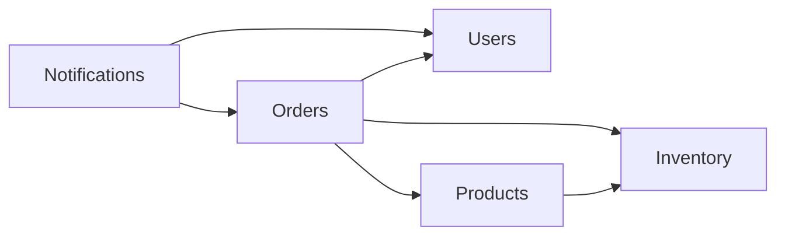

# NovaCart — Distributed Real-Time E-Commerce Platform

## 1. Purpose, authority, and milestone order

Build a small, secure, distributed shop for the Damascus University Internet Applications project (2026). The course emphasizes architecture, security, performance, scaling, and monitoring; frontend appearance and feature count are not assessment goals.

This specification separates **course requirements**, **repository design decisions**, and **observed implementation evidence**. A requirement or design described here is a target, not a claim that code exists or tests pass.

Source presentations, converted slide by slide into English:

- [Requirements 1 and 2](docs/requirements/requirements-1-2.md): 15 slides; abbreviated below as **R12**.
- [Requirement 3](docs/requirements/requirement-3.md): 12 slides; abbreviated below as **R3**.

The presentations govern course obligations. This file governs the repository's chosen implementation of those obligations. README descriptions, collection assertions, comments, and example scripts are supporting evidence, not proof of correctness. When they disagree, reconcile them explicitly rather than silently changing the course scope.

**Current priority:** establish and verify requirements 1 and 2 before implementing requirement 3. Requirement 3 is documented here for subsequent work. Requirements 4–6 are roadmap context only; their detailed specifications have not been supplied.

## 2. Course requirements and acceptance criteria

### Requirement 1 — API Design & Security

| ID | Course obligation | Acceptance evidence | Source |
| --- | --- | --- | --- |
| R1-01 | Register users; add/display products and images; create orders, manage inventory, track status | Demonstrate these functions through documented API requests | R12 slide 2 |
| R1-02 | Organize the core application into Users, Products, Orders, Notifications | Four domain modules with clear responsibilities and wiring; explain boundaries during assessment | R12 slide 5 |
| R1-03 | Run the complete project in separate Docker containers | A clean build and startup of the complete stack, persistent databases, reachable API | R12 slide 5 |
| R1-04 | Product creation with image, listing, category filtering, pagination | Valid upload displays with the product; filters return matching records; pagination has stable metadata | R12 slide 6 |
| R1-05 | Create/display orders and change their status | Customer creates and reads their order; administrator changes status according to the documented lifecycle | R12 slide 6 |
| R1-06 | REST version in the path, correct HTTP codes, one error format | All API routes share `/api/v1`; success and failure responses follow the selected contract | R12 slide 6 |
| R1-07 | Easily executable API documentation | Postman Collection, OpenAPI/Swagger, or equivalent covers the implemented interfaces and required demonstrations | R12 slide 6 |
| R1-08 | JWT authentication and role enforcement | Protected routes reject missing/invalid/expired tokens; public registration cannot grant admin privileges | R12 slide 7 |
| R1-09 | Customers see only their own orders; only admins change status | With two customers, foreign order read returns 403; customer status mutation returns 403 with no data changes; admin operations succeed | R12 slides 7–8 |
| R1-10 | Limit login attempts and provide basic security headers | Demonstrate 429 after the configured allowance; inspect security headers on successful and failed responses | R12 slide 7 |

The course permits the team to choose the language/framework. It requires testable documentation, not Swagger specifically. It does not specify an exact login threshold, error envelope, upload limit, or set of order statuses; those are repository decisions below.

### Requirement 2 — Inter-Service Communication

| ID | Course obligation | Acceptance evidence | Source |
| --- | --- | --- | --- |
| R2-01 | Independent inventory service in a different language or framework, owning a separate database | Core accesses inventory only over gRPC through a shared `.proto`; no direct inventory SQL or shared stock table | R12 slides 9–10 |
| R2-02 | Contract supports query, reserve, return quantity | Real gRPC requests demonstrate all three operations; existing additional `SetStock` supports administration | R12 slide 11 |
| R2-03 | Product details retrieve available quantity from warehouse | Changing warehouse stock changes the displayed quantity; catalog storage is not the stock authority | R12 slide 11 |
| R2-04 | One request reserves all items before order creation | A multi-item order either reserves all quantities or none; rejected reservation creates no order | R12 slide 11 |
| R2-05 | Insufficient stock rejects checkout with a clear message | HTTP 409 identifies shortages; local order and all inventory quantities remain unchanged on rejection | R12 slide 12 |
| R2-06 | Every call has a deadline; stopped/slow warehouse gets a clear response | Real outage and slow-service demonstrations finish within a measured bounded interval; checkout returns structured 503 | R12 slides 12–13 |
| R2-07 | Return reserved quantity when saving the order fails | Force local persistence failure after successful reservation; no order is committed and all reserved stock is restored | R12 slide 12 |
| R2-08 | Concurrent checkouts for the last unit yield exactly one winner | With stock 1 and multiple independent buyers, exactly one 201, all other requests 409, final stock 0, exactly one persisted order | R12 slide 13 |

The course does not prescribe SQL lock syntax, UUIDs, exact HTTP failure codes, or a 2000 ms deadline. These are chosen implementation details that make the course behaviors concrete.

## 3. Repository architecture decisions

### Core, inventory, and containers

- Laravel/PHP implements the REST core. The manifest currently requests Laravel `^13.17`; the app Dockerfile targets PHP 8.5. Use manifests/lockfiles and Dockerfiles for actual versions rather than older README labels. No framework upgrade is part of this specification work.
- `laravel-app/app/Modules/` holds Users (identity/JWT/roles), Products (catalog/categories/images), Orders (cart/checkout/ownership/lifecycle), and Notifications (user messages). The Inventory integration module is an adapter to the independent service, not a replacement for one of the four domain modules.
- Cross-module operations use explicit services/contracts. Database ownership remains clear. The course does not impose a blanket ban on joins within the core database.
- Node.js inventory uses gRPC and PostgreSQL. The shared contract is [inventory.proto](proto/inventory/v1/inventory.proto), package `inventory.v1`.
- Compose defines `app` (PHP-FPM), `web` (Nginx, host port 8080 by default), `db` (core PostgreSQL), `inventory` (internal gRPC port 50051), and `inventory-db` (separate PostgreSQL). Persistent volumes retain storage and database data.
- The core has no direct inventory database access. Inventory product identifiers correspond to catalog identifiers without cross-database foreign keys.
- Refresh/logout, cart, category administration, and persistent notifications are existing project design choices beyond the course's minimum endpoint list. Asynchronous notification delivery and WebSockets belong to a later milestone.

### Module ownership and public interfaces

The core is one deployable Laravel modular monolith. Each module owns its queries, models, controllers, and business rules. The shared database and existing foreign keys remain; they do not grant another module permission to query or relate to the owning module's models.

| Module | Owned data / responsibility | Public integration surface |
| --- | --- | --- |
| Users | Users, authentication, roles, recipient identity/delivery | `Users\PublicApi\Actor` and `UserDirectory`: actor identity, batch profile values, notification delivery to user IDs/admins |
| Products | Products, categories, images, catalog availability | `Products\PublicApi\Catalog` returns immutable `CatalogProduct` values; public stock/deletion errors and product lifecycle events |
| Orders | Carts, cart items, orders, order lines, checkout/lifecycle | Immutable `Orders\PublicApi\OrderSummary` and committed order events; subscribes to product deletion events using Orders-owned data |
| Notifications | Notification payloads, inbox/read-state queries | Consumes order snapshots and asks Users' public directory to deliver framework notifications; inbox queries are scoped by actor ID |
| Inventory adapter | PHP gRPC translation and deadlines | Existing `Inventory\Contracts`, `Data`, and `Exceptions`; generated messages/client code remain private to the adapter |

Allowed compile-time module dependencies are acyclic:



Cross-module reads return immutable snapshots or plain profile arrays, never Eloquent models, query builders, relationships, or HTTP resource objects. The authenticated user is accessed through the small `Actor` identity interface. Foreign IDs are scalar values; ORM relationships exist only between models owned by the same module. Profile and catalog enrichment is batched for entire order pages.

Products dispatches the synchronous public `ProductDeleting` event while holding its own product-row lock. Orders checks pending orders and history in its own tables and can refuse deletion or request retention. Products performs its own hard/soft deletion, then publishes `ProductRemoved`; Orders removes its own cart lines. This preserves the deletion rules without a Products-to-Orders import. The deletion guard must remain synchronous.

Committed order events carry readonly `OrderSummary` data and string status values rather than live models/enums. Notifications therefore uses the facts at dispatch time and cannot query or mutate Orders internals. Existing notification types, JSON fields, status transitions, and HTTP routes remain compatible.

Run the standalone dependency guard from `laravel-app/`:

```fish
php tests/Architecture/check-modules.php
```

It checks references against the public surfaces and dependency direction, and checks ownership/resolution of ORM relationship targets. `composer test:architecture` runs it too; `composer test` includes it before the Laravel suite. This is a source guard, not a complete semantic analyzer; runtime interface and authorization checks remain necessary. Factories, migrations, and integration tests outside `app/Modules/` may compose multiple modules to build fixtures/schema.

### REST compatibility baseline

Use the paths already exercised by the committed Postman collection and race script as the intended compatibility baseline. The merged application registers these routes; the verification pass exercised the principal workflows. See [the verification record](docs/verification/requirements-1-2.md) for outcomes and remaining checks.

All paths below are relative to `/api/v1`:

| Access | Method and path | Purpose |
| --- | --- | --- |
| Public | `POST /register`, `POST /login` | Customer registration and JWT login |
| Authenticated | `GET /me`, `POST /refresh`, `POST /logout` | Identity and token lifecycle |
| Public | `GET /` | Catalog listing with `page`, `category`; optional existing `q` search |
| Public | `GET /products/{id}` | Product details with live inventory quantity |
| Admin | `POST /admin/products` | Multipart product/image creation |
| Admin | `PUT /admin/products/{id}`, `DELETE /admin/products/{id}` | Existing catalog maintenance extension |
| Admin | `PATCH /admin/products/{id}/stock` | Absolute quantity update through gRPC `SetStock` |
| Admin | `GET/POST /admin/categories`, `PUT/DELETE /admin/categories/{id}` | Existing category management extension |
| Customer | `GET/DELETE /cart`, `POST/PATCH/DELETE /cart/{productId}` | Manage the customer's cart |
| Customer | `GET /checkout`, `POST /orders` | Preview and checkout the server-side cart |
| Customer | `GET /orders`, `GET /orders/{id}` | Own orders; foreign existing order returns 403 |
| Admin | `GET /admin/orders`, `PATCH /admin/orders/{id}/status` | All orders and privileged status updates |
| Authenticated | `GET /notifications`, `PATCH /notifications/{id}/read`, `POST /notifications/read-all` | Own notifications and read state |

Do not introduce `/auth/login`, move product creation to `/products`, or move admin status updates to the customer namespace solely to match the old SPEC. Any deliberate route change must update clients, documentation, and tests together.

Orders are created from the customer's cart (no client-supplied order prices). Validate positive integer quantities and existing product identifiers; resolve prices and total on the server and persist order-line price snapshots. Use exact monetary arithmetic. Product creation fields follow the collection: `title`, `description`, `price`, `category_id`, `image`, and initial `stock_quantity`. The upload target is JPG/PNG/WebP, at most 5 MB, validated by actual content/MIME and size.

Use lowercase order statuses as documented in the collection: initial `pending`; transitions `pending -> completed`, `pending -> cancelled`, `completed -> cancelled`. Cancellation returns inventory at most once. Other transitions return 422. This lifecycle is a project choice, including cancellation of completed orders; adding fulfillment/payment semantics requires an explicit design change.

### Response and security contract

Successful resource responses use a `data` payload; registration/login include the `token` consumed by existing clients. Product details expose `stock_quantity`; paginated listings include navigation/metadata. Preserve the existing field schemas and reconcile executable documentation when interfaces change.

Use the error envelope already asserted by the Postman collection and described in README:

```json
{
  "status": 422,
  "code": "validation_failed",
  "message": "The given data was invalid.",
  "errors": { "email": ["The email field must be a valid email address."] }
}
```

`status` is the numeric HTTP status, `code` is a stable machine-readable string, `message` is safe for clients, and optional `errors` contains field errors. The same shape applies to authentication, authorization, validation, missing-resource, throttle, service, and internal failures. Production errors exclude stack traces and credentials. Do not introduce the old SPEC's incompatible `success/error/timestamp` envelope.

| Situation | HTTP status |
| --- | --- |
| Resource/order created | 201 |
| Read/update successful | 200; 204 allowed for documented bodyless deletions |
| Missing/invalid/expired bearer token | 401 |
| Incorrect login credentials (existing validation-style contract) | 422 |
| Forbidden role or foreign existing order | 403 |
| Missing resource | 404 |
| Stock shortage or documented business conflict | 409 |
| Invalid input, empty cart, invalid transition | 422 |
| Rate limit exceeded | 429 |
| Unexpected local persistence failure | 500 |
| Inventory unavailable/deadline exceeded | 503 with `Retry-After: 5` |

JWT uses Bearer authentication, HS256 by default, and a 60-minute default lifetime per `config/jwt.php`. Validate identity and current authorization; derive ownership from the authenticated user rather than submitted user IDs. Keep secrets in the environment. Refresh/logout blacklisting is a project choice and must be verified separately from basic JWT issuance.

The existing `auth` limiter allows 6 requests per minute for normalized email plus IP; the global `api` limiter allows 60 per minute per authenticated identity or IP. Verify that sensitive routes actually attach these limiters. Test the auth limit without accidentally hitting the global limit first. Thresholds are project choices, not course numbers.

Provide `X-Content-Type-Options: nosniff`, `X-Frame-Options: DENY`, a suitable `Referrer-Policy`, and a restrictive Content Security Policy appropriate to the served content. Apply HSTS when HTTPS is deployed. Exact header policy is a project decision; the course asks for basic security headers. Authorization must occur before inventory or other privileged side effects.

## 4. Inventory contract, checkout, and failure semantics

The `.proto` is the authority for RPC names and wire types. Use `Reserve` and `Release`, not the old SPEC's inconsistent `ReserveStock`/`ReleaseStock` names.

| RPC | Chosen semantics |
| --- | --- |
| `GetStock` | Batch query by product IDs; unknown inventory products have quantity 0 |
| `Reserve` | One caller-supplied UUID `reservation_id`, all order items in one atomic transaction; result `RESERVED`, `REJECTED` with shortages, or `RELEASED` |
| `Release` | Return a reservation's stock once; repeated release is safe; an early release prevents a delayed reserve using that ID |
| `SetStock` | Set an absolute nonnegative quantity for an authorized admin action routed through the core |

Validate inventory requests independently of HTTP validation. Normalize duplicate product lines consistently and reject malformed/nonpositive quantities. A repeated reservation with the same ID and same normalized payload must not deduct stock twice; reuse with different items must be rejected clearly. Keep reservation outcome and stock changes consistent in one database transaction.

Choose transactional row locking (`SELECT ... FOR UPDATE`) with locks acquired in sorted product-ID order, plus a database `CHECK (quantity >= 0)`. If any line is short, no line is deducted. Serialize reservation/release races by reservation ID as well as product rows; product locks alone do not establish reservation idempotency. Verify `SetStock`, reservation, and release do not lose concurrent updates.

Checkout coordination is **reservation followed by local commit with compensation**, not a distributed two-phase commit protocol:

1. Authenticate and validate the cart; snapshot requested items and authoritative prices.
2. Generate a stable reservation UUID for this checkout attempt and call `Reserve` once for all items.
3. On `REJECTED`, return 409 with shortages and create no order. `RELEASED` must not be treated as a successful reservation.
4. On `RESERVED`, save the order and lines in a local transaction, associate its reservation UUID, then return 201 after commit.
5. If saving fails, roll back the local transaction and invoke idempotent `Release` for that UUID. Verify stock restoration and return a structured local failure.
6. Clear the cart and create notifications according to committed order state. A notification failure after commit must not release stock for an already committed order.

Every RPC has an explicit deadline, default `INVENTORY_TIMEOUT_MS=2000`. Map unavailable/expired-deadline calls to a safe 503 response. Measure end-to-end duration, accounting for any compensation calls; a per-call deadline does not imply the entire HTTP request finishes in exactly 2000 ms.

A timed-out reserve may have executed remotely. Use the same reservation UUID for cleanup/reconciliation; never blindly create a second reservation on retry. The early-release behavior in the `.proto` addresses delayed reserve arrival, but does not by itself solve process crashes or failed compensation. If release also fails, retain a durable recovery record and retry/reconcile it, or explicitly report that recovery as unimplemented. Never claim a best-effort release guarantees no leaked reservations under every failure.

For catalog browsing during outage, the existing outage collection expects catalog data to remain available with `stock_quantity: null` (unknown), while checkout returns 503. An unknown quantity must not be presented as real zero or used as permission to accept an order. Successful product detail requests retrieve current quantity through `GetStock`.

## 5. Verification gate for requirements 1 and 2

Completion requires executable evidence, not just source files or mocked tests. Record commands, environment, assertions, and outcomes when this gate is run.

| Check | Required observation |
| --- | --- |
| Complete startup | All service build contexts and providers exist; clean Docker build/start, migrations, seed and health checks succeed |
| Core API/security | Registration/login, image validation, category filtering, pagination, cart checkout, status tracking, notifications, standardized errors and headers |
| Required authorization proof | Two distinct customers; foreign order access and admin-only mutation fail without side effects; admin succeeds |
| JWT and throttling | Missing/invalid/expired tokens rejected; public role escalation rejected; configured login allowance leads to 429 |
| Real inventory contract | `GetStock`, multi-item atomic rejection/success, idempotent reserve/release, early release and duplicate payload handling |
| Required last-unit proof | At least two buyers with independent carts; one 201, all others 409, final stock 0, one saved order |
| Required outage proof | Stopped and slow inventory cases return bounded, structured failures; browse shows unknown stock; normal checkout recovers when service is available |
| Compensation proof | Forced persistence failure after reservation restores every quantity, creates no order; failed cleanup is recoverable or explicitly recorded as a gap |
| Documentation/workflow | Executable documentation matches routes; required teammate-reviewed PR participation evidence exists |

Use Laravel HTTP tests for authorization, validation, and orchestration. An `InventoryGateway` fake can isolate core behavior, but cannot prove PostgreSQL locking, gRPC interoperability, or network deadlines. Verify those against the real Node.js/PostgreSQL service and run concurrency through the public API. SQLite tests cannot prove PostgreSQL concurrency behavior.

Existing artifacts:

- [Main Postman collection](docs/api/NovaCart.postman_collection.json).
- [Outage Postman collection](docs/api/NovaCart-inventory-outage.postman_collection.json).
- [Race demonstration](docs/demo/race-condition.mjs).

### Current implementation and verification — 2026-11-10

The user pulled merged main at `5e06d54`, including all four core domains and the inventory branch. Work continues on `fix/requirements-1-2-verification`; earlier reports of missing implementation files referred to the infrastructure-only branch and no longer describe this checkout.

**Architecture:** a modular Laravel monolith plus the independent inventory service required by requirement 2. Core domains share one Laravel runtime and core database, with in-process calls/events. Node inventory owns its separate database and exposes gRPC. Nginx/PHP/database containers do not turn each core domain into a microservice. The architecture cleanup removed direct cross-module model/resource access, replaced it with public data/identity interfaces and snapshot events, and added the dependency guard described above.

See [the verification record](docs/verification/requirements-1-2.md) for environment, exact scope, reproducible demos, failure evidence, applied changes, and rollback limitations. Current evidence:

- 15 real gRPC/PostgreSQL tests passed, including new replay regressions and a legacy-schema upgrade test.
- HTTP security/catalog/order/lifecycle checks passed through cached Nginx/PHP-FPM with separate database containers.
- Last-unit race: 10 buyers, one 201, nine 409s, one saved order, stock 0.
- Stopped inventory: bounded 503, unknown stock while browsing, and recovery after service IP change passed.
- Slow inventory: bounded response and eventual cleanup of a delayed reservation passed.
- Forced order-line persistence failure after real reservation rolled back the order, restored stock, and preserved the cart.
- Fresh build remains unverified: the offline attempt lacked cached Composer archives. The full PHPUnit suite is also pending because development dependencies are unavailable. Hosted branch-protection/participation evidence remains unchecked.
- Failed compensation currently logs its reservation ID but has no durable retry/reconciliation mechanism; process-crash recovery is not guaranteed.

The verification gate remains open for the pending checks. Passing demonstrations do not establish complete milestone readiness. Requirement 3 remains deferred.

## 6. Requirement 3 — deferred performance and caching milestone

Implement after the requirements 1–2 verification gate passes. Preserve JWT/ownership protections, inventory authority, reservation atomicity, and bounded failure handling throughout optimization.

| ID | Course obligation | Future acceptance evidence | Source |
| --- | --- | --- | --- |
| R3-01 | Measure, change one thing, measure again | Comparable baseline/after runs with explanations; unsupported speed claims do not count | R3 slides 3–4 |
| R3-02 | Realistic database scale and query optimization | Hundreds of thousands of synthetic orders, recorded `EXPLAIN` plans, justified indexes/query changes, identified and fixed N+1 queries | R3 slide 6 |
| R3-03 | Automatically replicated read-only database | Writes go to primary; eligible reads use replica; prove actual replication and read routing | R3 slide 7 |
| R3-04 | Read-your-writes despite replication lag | User immediately sees a newly created entity and product changes; test with replication delay | R3 slides 7, 11 |
| R3-05 | Redis caching for frequently read data | Defined keys and TTLs, correct invalidation after mutations, no stale product output | R3 slide 8 |
| R3-06 | HTTP conditional caching | Product response has ETag; matching conditional request returns bodyless 304; mutation changes data/ETag | R3 slide 9 |
| R3-07 | Reproducible load testing | Same k6/equivalent workload before/after; report p50, p95, p99 and requests/second; explain observed behavior | R3 slides 10–11 |

Future implementation decisions to make from measured evidence:

- Select slow endpoints, datasets, concurrency, duration, warmup, and comparable cache conditions. Record hardware/runtime settings, query counts, failures, and latency units. The course gives no numeric latency or throughput threshold.
- Choose indexes from query plans and explain write/storage costs. Keep correctness checks alongside performance measurements.
- Route consistency-sensitive reads to the primary or use another demonstrated read-your-writes mechanism. Define its scope across separate HTTP requests; same-request connection stickiness alone may not satisfy the demonstration.
- Define Redis keys with all relevant pagination/filter/authorization dimensions. Invalidate after committed mutations. Prevent an old replica read from refilling a just-invalidated cache with stale data.
- Keep the inventory service authoritative for reservation decisions. Cached availability never replaces atomic `Reserve`; separate cacheable catalog fields from changing stock as needed.
- ETags must describe the actual selected representation, including stock if stock is included. Use `If-None-Match` for conditional requests. Keep private order/notification data out of shared public caches.
- A bodyless 304 is a valid protocol response, not an error requiring the JSON error envelope.

Redis, a read replica, synthetic bulk data, and load tests are documented future work here. This task does not install, provision, seed, or benchmark them.

## 7. Scope and team workflow

Requirements 1–2 exclude payment providers, frontend visual polish, discounts/reviews/shipping integrations, and requirement 3 optimizations. Basic Notifications remains a required module; only asynchronous/real-time delivery is deferred. Requirements 4–6 concern asynchronous/real-time processing, scaling/load distribution, and monitoring/fault tracing; specific broker/APM products are not mandated by the supplied decks.

Course workflow: one Git repository, protected main branch, teammate-reviewed pull requests for every change, and at least one PR per member per requirement. Any member may be questioned about any component (R12 slide 14). Branch protection and participation require repository-host evidence, which has not been checked here.

The earlier spec's A–E division can remain an indicative team plan: infrastructure; users/security; products/documentation; orders/notifications; inventory/gRPC. These assignments and branch names are not instructor requirements and do not limit collective responsibility.
